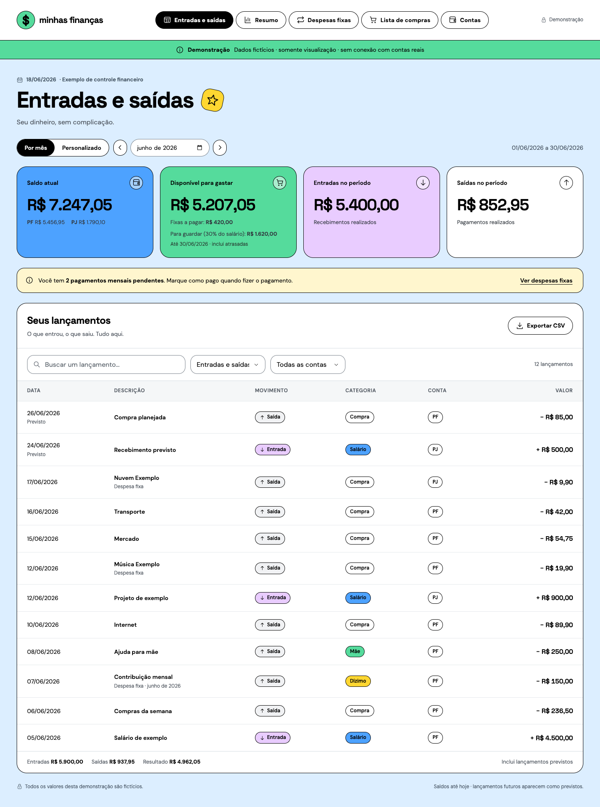

# Minhas finanças

Controle pessoal de entradas, saídas e despesas fixas, com interface em
português,
contas PF/PJ e navegação horizontal. Desenvolvido para desktop com Cloudflare
Workers e D1.

## Visualização sem dados reais

[Abrir demonstração pública][demo]

A demonstração não exige senha. Todos os saldos, descrições, datas e lançamentos
são fictícios. É possível explorar as abas, pesquisar, filtrar períodos e
exportar
os exemplos em CSV. A página não consulta a API privada nem acessa o banco real.
Os controles que alteram registros ficam ocultos.



## Funcionalidades

- Entradas e saídas com descrição, valor, data, categoria e conta.
- Categorias Salário, Compra, Dízimo e Mãe.
- Filtros por mês, intervalo personalizado, conta e movimento.
- Resumo financeiro, distribuição por categoria e totais mensais.
- Card de disponível para gastar: saldo atual menos fixas a pagar até o fim
  do mês atual e 30% dos salários recebidos para guardar. Inclui pendências
  anteriores e respeita a conta filtrada.
- A reserva de salário acumula entre meses; previsões não reservam dinheiro
  antes do recebimento. O saldo e os lançamentos permanecem separados
  desse cálculo. O dízimo continua nas fixas, sem desconto em duplicidade.
- Uma reserva inicial privada pode cobrir salário já incluído no saldo
  informado, sem criar outra entrada.
- Fixas já pagas não são descontadas duas vezes; recebimentos futuros não
  aumentam o disponível. Se faltar saldo para a reserva, o card informa o valor.
- Despesas a cada 30 dias, mensais sem prazo ou com vencimento único.
- Lançamentos automáticos com proteção contra duplicação.
- Saldos iniciais editáveis e identificação de lançamentos previstos.
- Lista de compras com itens editáveis, valores estimados e total da lista.
- As estimativas de compras não alteram os saldos nem geram lançamentos.
- Acesso privado por senha, sessões protegidas e troca de senha.

## Tecnologia

- TypeScript e Vite, sem framework de interface.
- Cloudflare Workers para API e arquivos estáticos.
- Cloudflare D1 para persistência.
- Valores armazenados em centavos inteiros e datas no fuso de São Paulo.
- Fontes e ícones servidos pelo próprio site.

## Executar localmente

Requisitos: Node.js 22.18 ou superior, npm e Chrome para os testes de navegador.

```bash
npm ci
npm run setup:local
npm run dev -- --host 127.0.0.1
```

Em outro terminal, inicialize o banco local:

```bash
npm run db:local
```

Abra `http://127.0.0.1:5173` e use a senha gerada em `.dev.vars`.
A visualização fictícia fica em `http://127.0.0.1:5173/demo`.
Instalações novas começam com saldo zero e sem despesas pessoais.

O banco local fica em `~/.local/share/minhas-financas/state`, fora da pasta do
projeto, para evitar conflitos com ferramentas de sincronização de arquivos.
Defina `FINANCE_LOCAL_STATE` para usar outra pasta, como um banco descartável de
testes separado dos seus dados locais.

## Publicar na sua Cloudflare

Autentique o CLI com `npx cf auth login`, crie seu D1 e configure os
identificadores
da conta e do banco. Há duas opções:

- Variáveis `CLOUDFLARE_ACCOUNT_ID` e `FINANCE_DATABASE_ID`.
- Arquivo ignorado `deployment.local.json`, com as chaves `accountId` e
  `databaseId`.

A configuração fica em `cloudflare.config.ts`. Aplique
os arquivos SQL de `migrations/` em ordem ao seu banco e configure o segredo
`BOOTSTRAP_PASSWORD` no Worker antes de usar o acesso privado.

```bash
npm run typecheck
npm test
npm run deploy
```

O Cron registra despesas automáticas diariamente às 06h de São Paulo.
A API também concilia ocorrências pendentes quando o aplicativo é aberto.
Essa automação apenas registra lançamentos; ela não faz pagamentos bancários.

## Usar contas diferentes por projeto

O CLI permite manter os logins pessoal e de trabalho em perfis separados.
Na pasta deste projeto, autentique e associe seu perfil pessoal uma vez:

```bash
npx cf auth create pessoal
npx cf auth activate pessoal
npx cf auth whoami
```

Na pasta de um projeto de trabalho, use outro perfil:

```bash
npx cf auth create trabalho
npx cf auth activate trabalho
```

A associação vale para a pasta e suas subpastas, sem encerrar o outro login.
Depois da configuração, publique com `npm run deploy`. Para conferir os perfis,
use `npx cf auth list`. A autenticação pode precisar ser refeita se for revogada.

Consulte a [documentação de perfis do CLI][profiles].

## Testes

```bash
npm run typecheck
npm test
npm run test:demo
npm run build
```

`test:demo` usa o servidor local por padrão. Para validar outro ambiente, defina
`PREVIEW_ORIGIN` com a origem do site. O teste verifica filtros, abas,
exportação,
layout, bloqueio dos controles de escrita e ausência de chamadas à API privada.

Os testes de integração utilizam apenas fixtures fictícias e um banco local
descartável. Não execute fixtures em produção:

```bash
npm run db:local -- --fixtures
npm run test:browser
npm run test:shopping
npm run test:auth
```

## Privacidade

O repositório contém código e exemplos fictícios. Senhas, sessões, backups,
identificadores locais de infraestrutura e dados financeiros não são
versionados.
O aplicativo privado exige autenticação em todas as rotas de dados.
A demonstração utiliza um conjunto separado em `src/demo.ts`, sem persistência.

As licenças das fontes estão em `public/fonts`.

[demo]: https://minhas-financas-pessoais.carvalhodiogo746.workers.dev/demo
[profiles]: https://developers.cloudflare.com/cf/get-started/#use-named-profiles
